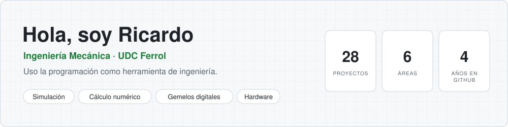
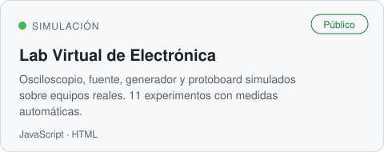
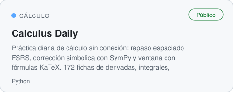
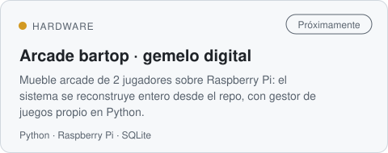
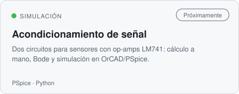
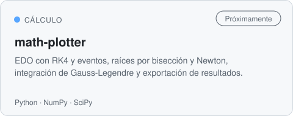

<!-- Generado desde el hub privado perfil-github (plantilla/README.md + proyectos.json). -->

<picture><source media="(prefers-color-scheme: dark)" srcset="assets/cabecera-dark.svg"></picture>

  
  

### Proyectos

<a href="https://ricardoeee.github.io/Modelo-laboratorio-electronica/"><picture><source media="(prefers-color-scheme: dark)" srcset="assets/tarjetas/Modelo-laboratorio-electronica-dark.svg"></picture></a> <a href="https://github.com/RicardoeeE/calculus-daily"><picture><source media="(prefers-color-scheme: dark)" srcset="assets/tarjetas/calculus-daily-dark.svg"></picture></a>
<picture><source media="(prefers-color-scheme: dark)" srcset="assets/tarjetas/Arcade-dark.svg"></picture> <picture><source media="(prefers-color-scheme: dark)" srcset="assets/tarjetas/electronica-circuitos-dark.svg"></picture>
<picture><source media="(prefers-color-scheme: dark)" srcset="assets/tarjetas/math-plotter-dark.svg"></picture>

Los marcados como privados o «próximamente» los voy abriendo según quedan listos y documentados.

### Cómo trabajo

- **Mido antes de opinar.** Primero datos o pruebas; las decisiones salen de ahí. Cada simulación se contrasta con el cálculo: si no cuadran, uno de los dos está mal.
- **Todo reproducible.** Cualquier resultado se puede rehacer desde el repo: datos, código y versiones.
- **Documento el porqué.** Cada decisión queda escrita con su motivo, para quien venga después (yo incluido).
- **Del dato al modelo.** Me interesa el recorrido completo: recoger el dato, limpiarlo, guardarlo bien y convertirlo en un modelo que explique o prediga.

### Qué me interesa

- **Gemelos digitales y modelos basados en datos.** Objetos físicos con un modelo vivo que se actualiza con medidas reales.
- **Elementos finitos.** Lo que más me atrae ahora mismo. Estoy empezando y quiero llegar a combinarlo con gemelos digitales.
- **Modelado estadístico y físico-matemático.** Incertidumbre, regresión, EDOs y simulación numérica: la base de todo lo anterior.
- **Datos a escala.** Aprender a manejar grandes volúmenes (series temporales, sensores) sin perder la trazabilidad.

### Herramientas

---

<i>Si se puede medir, se puede modelar; si se puede modelar, se puede mejorar.</i>

