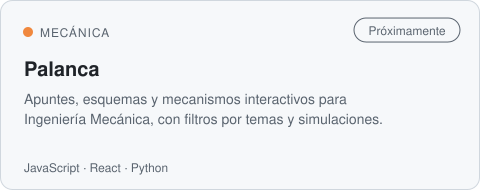
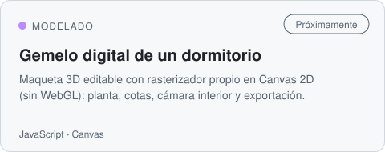
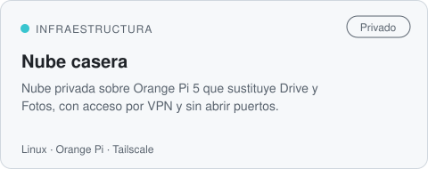
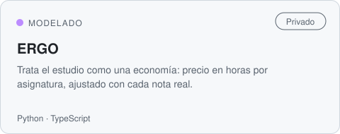

<!-- Generado desde el hub privado perfil-github (plantilla/README.md + proyectos.json). -->

<picture><source media="(prefers-color-scheme: dark)" srcset="assets/cabecera-dark.svg"></picture>

  
  

### Proyectos

<a href="https://github.com/RicardoeeE/Modelo-laboratorio-electronica"><picture><source media="(prefers-color-scheme: dark)" srcset="assets/tarjetas/Modelo-laboratorio-electronica-dark.svg"></picture></a> <picture><source media="(prefers-color-scheme: dark)" srcset="assets/tarjetas/Arcade-dark.svg"></picture>
<picture><source media="(prefers-color-scheme: dark)" srcset="assets/tarjetas/Palanca-dark.svg"></picture> <picture><source media="(prefers-color-scheme: dark)" srcset="assets/tarjetas/gemelo-digital-dormitorio-dark.svg"></picture>
<picture><source media="(prefers-color-scheme: dark)" srcset="assets/tarjetas/electronica-circuitos-dark.svg"></picture> <picture><source media="(prefers-color-scheme: dark)" srcset="assets/tarjetas/math-plotter-dark.svg"></picture>
<picture><source media="(prefers-color-scheme: dark)" srcset="assets/tarjetas/drive-casero-dark.svg"></picture> <picture><source media="(prefers-color-scheme: dark)" srcset="assets/tarjetas/ERGO-dark.svg"></picture>

Los marcados como privados o «próximamente» los voy abriendo según quedan listos y documentados.

### Cómo trabajo

- **Primero el modelo.** Ecuaciones y cálculo a mano antes que código; el código va después, para comprobar y para iterar.
- **Simular y contrastar.** Cada simulación se compara con el cálculo: si no cuadran, el que está mal es uno de los dos.
- **Gemelos digitales.** Si algo existe en el mundo físico, su descripción vive en un repo y se puede reconstruir desde cero.
- **IA local y datos propios.** Prefiero gestionar mi información a depender de la nube.

### Herramientas

---

<i>Prefiero la profundidad que dura a la superficie que caduca.</i>

